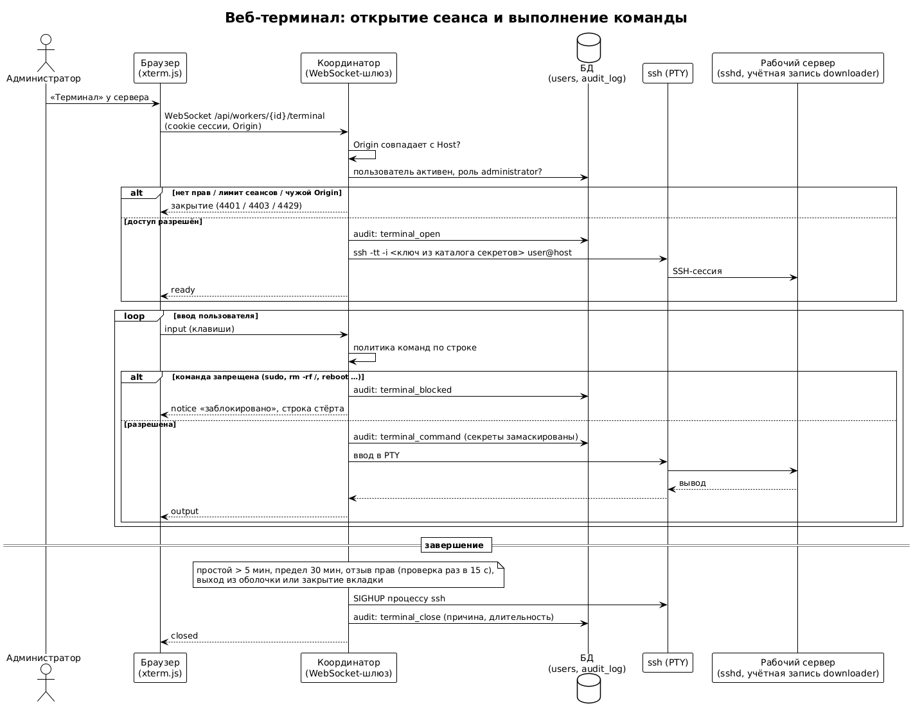

Репозиторий проекта: <https://gitflic.ru/project/albertdevops/ultraproject>

# Цель и постановка

Разработан программный комплекс из координатора, агентов рабочих серверов, веб-интерфейса и реляционного хранилища состояния. Система обходит диапазон числовых идентификаторов, проверяет наличие видеоматериала, получает метаданные, скачивает файлы и распределяет работу между серверами небольшими арендуемыми блоками. Главный принцип: **координатор управляет состоянием и раздаёт небольшие блоки с арендой, агенты самостоятельно выполняют ограниченную параллельную обработку и регулярно сообщают прогресс**.

Реализация на Python: FastAPI, SQLAlchemy 2.0, Alembic, PostgreSQL 16; агент — только стандартная библиотека; веб-интерфейс — HTML, Alpine.js, Chart.js, xterm.js; стенд — docker compose (координатор, PostgreSQL, mock-сервис и три сервера с sshd). Диаграммы — PlantUML (исходники в `docs/diagrams/`).

## Целевой сервис и безопасность обхода

Работа выполняется **только с собственным управляемым mock-сервисом** (раздел 20 задания), а не с внешним сервисом. Шаблон адреса по умолчанию — `http://mock:8080/{id}`. Координатор принимает только адреса из белого списка хостов (`VF_ALLOWED_TARGET_HOSTS`), а агент дополнительно проверяет, что ссылка на файл ведёт на тот же хост, что и шаблон задания. Ответы 401/403 фиксируются как «недоступно» без попыток обхода.

Mock-сервис детерминированно генерирует результат для каждого идентификатора (200/404/403), умеет отдавать файлы разных размеров с поддержкой `Range` и контрольной суммой SHA-256, а через управляющее API включает задержки, ответы 429 с `Retry-After`, случайные 500 и обрывы соединения.

# Архитектура

{width=100%}

**Координатор** (FastAPI) хранит всё достоверное состояние в PostgreSQL и после перезапуска восстанавливает его из БД. Он включает HTTPS API и статику интерфейса, аутентификацию и аудит, сервис заданий (диапазоны и автомат состояний), сервис аренды блоков, мониторинг (предупреждения, активные загрузки, экспорт), фоновый Reaper, SSH-развёртыватель агентов и SSH-шлюз веб-терминала. Для производительности координатор запускается несколькими процессами uvicorn (по умолчанию 4); фоновый Reaper защищён рекомендательной блокировкой PostgreSQL, поэтому работает только в одном из процессов.

**Агент** (только стандартная библиотека Python, `psutil` опционально) регистрируется, шлёт heartbeat с метриками, берёт блок, обрабатывает его пулом потоков, скачивает файлы и отчитывается контрольными точками. Агент никогда не получает весь диапазон целиком.

{width=80%}

## Динамические блоки и аренда

Диапазон делится на блоки настраиваемого размера (по умолчанию 1000 идентификаторов). Для открытого диапазона новые блоки создаются по мере выдачи, под блокировкой строки задания. Выдача блока атомарна: `SELECT … FOR UPDATE SKIP LOCKED` не позволяет выдать один блок двум агентам. Блок с истёкшей арендой выдаётся повторно другому серверу и продолжается с контрольной точки `next_id`. Интервал heartbeat — 5 с, тайм-аут heartbeat — 30 с, срок аренды — 60 с (настраиваются).

Выдача блоков учитывает состояние сервера: серверу, у которого свободного места меньше установленного резерва (`min_free_space_gb`), новые блоки не выдаются (причина `disk_low`); отключённые и неактивные серверы блоков не получают.

Гарантия — **at least once**: повторная обработка возможна, поэтому сохранение результатов идемпотентно (`INSERT … ON CONFLICT DO UPDATE` по `(job_id, external_id)`, уже `completed` не затирается, `next_id` двигается только вперёд, повторное `lease` и `complete` безопасны).

{width=100%}

## Состояния задания

Переходы определены формально (`coordinator/app/statuses.py`); конечные состояния — `stopped`, `completed`, `failed`. Завершённое задание нельзя перевести в `running`; повторить ошибочные элементы можно только созданием новой попытки (см. раздел «Веб-интерфейс»). Мягкая пауза (`pausing → paused`) запрещает выдачу новых блоков и даёт доработать выданные; остановка освобождает аренды и сохраняет контрольные точки.

Задание завершается при ручной остановке, при достижении явного предела (`max_ids`, `max_runtime_seconds`), при выполнении **необязательного** условия `stop_on_consecutive_missing` (по умолчанию отключено, так как пропуски не доказывают отсутствие материалов с большими идентификаторами), при отсутствии работоспособных серверов или критической ошибке конфигурации.

{width=75%}

# Модель данных

Создано 15 таблиц (включая справочник ролей), миграции Alembic проверены на PostgreSQL. Агент передаёт вместе с результатом метаданные материала и описание скачанного файла; координатор идемпотентно сохраняет их в `media_metadata`, `downloads` и `files` (повторная отправка не создаёт дублей, при ошибке загрузки метаданные сохраняются без записи о файле). **Даты.** «Дата обнаружения» (`media_metadata.discovered_at`) — момент, когда система впервые получила метаданные найденного материала (ответ 200 целевого сервиса); это не время создания задания и не время загрузки файла. «Дата загрузки» хранится отдельно: начало и конец загрузки (`downloads.started_at`, `finished_at`) и время появления файла (`files.completed_at`). Всё время хранится в UTC. Уникальные ограничения защищают от дубликатов: `items(job_id, external_id)`, `range_chunks(job_id, range_start, range_end)`, `files(download_id, storage_path)`.

{width=100%}

# Агент

**Проверка идентификатора.** 200 → найдено, метаданные из JSON; 404 → `not_found`; 401/403 → `forbidden`; 429 → пауза всех потоков на `Retry-After` (лимит ожиданий, затем `rate_limited`); 5xx и сетевые ошибки → повтор с задержкой `min(cap, base·2^n)` и полным джиттером, затем `failed`.

**Загрузка.** Файл пишется в `*.part`, при обрыве докачивается заголовком `Range` с того же места (если сервер игнорирует `Range` — начинается заново), затем проверяются размер и SHA-256 и выполняется атомарное переименование; рядом записывается `metadata.json`. Если после докачки поверх **старого `.part`-файла** контрольная сумма не совпала (файл был повреждён, например после сбоя диска), агент удаляет его и один раз скачивает файл с нуля; повреждённый результат никогда не публикуется. Уже скачанный и проверенный файл повторно не загружается. Перед загрузкой проверяется свободное место.

**Структура хранения и безопасность путей.** Файлы сохраняются как `{хранилище}/{префикс}/{id}/video.{расширение}` и `metadata.json` рядом (префикс — `id // 1 000 000`, например `200/200673499/`; расширение — по MIME-типу). Название материала в пути **не участвует** (хранится только в `metadata.json` и в БД), поэтому враждебные названия (`../../etc/passwd`, управляющие символы, зарезервированные имена) не могут повлиять на путь. Итоговый путь проверяется на нахождение внутри каталога хранения (включая символьные ссылки); `metadata.json` пишется атомарно. Координатор, в свою очередь, принимает от агента только относительный путь без `..`, абсолютных и пустых частей.

**Ограничение частоты и адаптивное снижение нагрузки.** Общий для потоков ограничитель запросов в секунду настраивается на лету; пауза после 429 действует на все потоки. Поверх него работает адаптивный регулятор (схема AIMD): в окне из 20 ответов доля 429/5xx и сетевых ошибок не менее 20 % уменьшает масштаб нагрузки вдвое (минимум 10 %); ответ 429 уменьшает его сразу, не чаще раза в 2 с; при безошибочных окнах масштаб растёт на 0,1 до единицы. Число активных потоков равно `round(threads × масштаб)`, поэтому увеличение числа потоков не отключает ограничения. Текущий масштаб передаётся в heartbeat и показывается в интерфейсе («замедлен ×0.5»).

**Контрольные точки.** Контрольная точка блока — первый незавершённый идентификатор, поэтому при отказе повторная работа минимальна. Числа потоков и лимиты, изменённые в интерфейсе, агент подхватывает из ответа на `progress` без остановки задания.

**Устойчивость к сбоям координатора.** Ответы 5xx и недоступность координатора агент пережидает и повторяет, не считая это ошибкой блока; ошибки 4xx (нарушение протокола) не скрываются. Потеря аренды (`409 lease_lost`) приводит к тихому отказу от блока.

# Веб-интерфейс

Страница `/ui/` (опрос API раз в 2 секунды, метрики серверов обновляются не реже раза в 5 с). Интерфейс адаптивный: пригоден для настольных и мобильных экранов.

- **Вход и роли.** Форма входа; кнопки и вкладки показываются в соответствии с ролью пользователя.
- **Вкладка «Задания»:** создание (диапазон, размер блока, потоки, лимит запросов, серверы, поле «Стоп после N подряд отсутствующих»), список, прогресс-бар, счётчики результатов с фильтром, блоки, элементы с пагинацией, таблица скачанных файлов (название, размер, SHA-256, путь, сервер), события; запуск, пауза, продолжение, остановка; изменение числа потоков и лимита на лету, глобально и по каждому серверу; отключение сервера в задании.
- **Активные загрузки.** Карточка показывает, какие файлы скачиваются прямо сейчас: сервер, идентификатор, название, прогресс и скорость каждой загрузки.
- **Предупреждения.** Баннер с текущими предупреждениями (см. раздел «Мониторинг»).
- **Экспорт и повтор.** «Экспорт CSV» и «Экспорт JSON» выгружают результаты задания с фильтром по статусу; «Повторить ошибочные (N)» создаёт новую попытку задания для элементов со статусом `failed`.
- **Вкладка «Серверы»:** добавление, статус, версия агента, свободное место, время heartbeat, индикатор замедления; проверка SSH, развёртывание, запуск, остановка агента, отзыв токена; кнопка «Терминал»; графики метрик (ID/с, скорость загрузки, CPU, активные запросы).
- **Вкладка «Пользователи и аудит»** (администратор): пользователи, роли, журнал аудита с фильтром по действию.

Повтор ошибочных: новое задание (попытка +1) создаётся на диапазон от наименьшего до наибольшего ошибочного идентификатора с теми же серверами; уже завершённые файлы агент пропускает, поэтому повторно обрабатываются фактически только ошибочные элементы.

# Мониторинг и предупреждения

Агент передаёт в heartbeat технические метрики (загрузка CPU, RAM и swap, свободное и общее место на диске, сетевой трафик, дисковый ввод-вывод, число открытых файлов; без `psutil` — load average) и прикладные (идентификаторов в секунду, байт в секунду, число активных проверок и загрузок, распределение HTTP-статусов, прогресс каждой загрузки, масштаб адаптивного снижения нагрузки). Координатор хранит их в `worker_metrics` и показывает графиками; состояние блоков и повторы видны в списке блоков задания.

Предупреждения вычисляются на лету (`GET /api/alerts`) и показываются баннером:

| Код | Условие |
|:----------|:----------------------------------------------|
| `worker_offline` | агент перестал отправлять heartbeat |
| `disk_low` / `disk_low_soon` | свободного места меньше резерва / осталось менее 150 % резерва (прогноз заполнения) |
| `throttled` | агент снизил нагрузку из-за 429/5xx |
| `job_stalled` | у работающего задания нет новых результатов более 120 с |
| `high_error_rate` | не менее 20 % ошибочных элементов за 300 с (при выборке от 10 элементов) |
| `rate_limited` | целевой сервис отвечает 429 |
| `chunk_failed`, `chunk_retries` | блок завершился ошибкой / выдан три и более раза |

# API

| Метод | Путь | Назначение | Роль |
|:--|:--------------|:----------------------------|:----|
| POST | `/api/auth/login`, `/logout`; GET `/api/auth/me` | вход, выход, текущий пользователь | — |
| POST/GET | `/api/jobs`, `/api/jobs/{id}` | создание, список, карточка со статистикой | operator / viewer |
| PATCH | `/api/jobs/{id}` | изменение потоков и лимитов на лету | operator |
| POST | `/api/jobs/{id}/start`, `pause`, `resume`, `stop` | управление заданием | operator |
| POST | `/api/jobs/{id}/retry-failed` | новая попытка для ошибочных элементов | operator |
| PUT | `/api/jobs/{id}/workers/{wid}` | параметры сервера в задании | operator |
| GET | `/api/jobs/{id}/items`, `files`, `chunks`, `events` | результаты, скачанные файлы, блоки, журнал | viewer |
| GET | `/api/jobs/{id}/export?format=csv\|json&status=` | выгрузка результатов (потоком) | viewer |
| GET | `/api/alerts`, `/api/downloads` | предупреждения, активные загрузки | viewer |
| POST/GET/PATCH | `/api/workers`, `/api/workers/{id}` | серверы | administrator / viewer |
| GET | `/api/workers/{id}/metrics` | метрики | viewer |
| POST | `/api/workers/register`, `/{id}/heartbeat`, `lease`, `progress`, `complete`, `fail` | протокол агента (токен агента) | агент |
| POST/GET | `/api/workers/{id}/agent/check`, `deploy`, `start`, `stop`, `token/revoke`; `GET .../agent` | управление агентом по SSH | administrator |
| WebSocket | `/api/workers/{id}/terminal` | SSH-терминал | administrator |
| GET/POST/PATCH | `/api/users`; GET `/api/audit` | пользователи, журнал аудита | administrator |

Ошибки возвращаются как `{"error": "<код>", "message": "..."}` с HTTP-кодами 401/403/404/409/422/429/502. Полная интерактивная документация — `/docs`.

# Безопасность

Реализовано:

- Секреты вне кода и БД: для сервера хранится только ссылка `ssh_key_ref` на файл внутри каталога секретов (`/run/secrets`), в ответах API она не отображается; тест проверяет, что содержимое ключа не попадает в ответы, команды и события.
- Развёртывание только по SSH-ключам (`BatchMode=yes`), отпечаток хоста запоминается при первом подключении; все значения в команде проходят строгие шаблоны (защита от внедрения аргументов), ключ обязан лежать внутри каталога секретов, обход через символьные ссылки блокируется.
- Проверка входных параметров (Pydantic): диапазоны, пути хранилища (абсолютные, без `..`), имена; белый список целевых хостов.
- Агент работает без прав root; запись только внутри каталога хранения.
- Веб-интерфейс выводит данные через `x-text` (экранирование), данные не вставляются через `innerHTML`; Content-Security-Policy ограничивает источники скриптов.
- Экспорт защищён от инъекции формул: значения CSV, начинающиеся с `=`, `+`, `-`, `@`, получают префикс `'`.

## Аутентификация, роли и аудит

- **Вход.** Пароли хранятся только как хеш scrypt с индивидуальной солью; требования: не менее 10 символов, строчные и заглавные буквы и цифры. Сессия — подписанная HMAC cookie `vf_session` (`HttpOnly`, `SameSite=Strict`, `Secure` при HTTPS, срок 8 часов). Права пользователя читаются из БД при каждом запросе, поэтому отключение учётной записи или смена роли действуют немедленно. Для неизвестного пользователя выполняется то же вычисление хеша, ответ одинаков: имя не угадывается ни по тексту, ни по времени. Перебор ограничен: 5 неудач для пары «адрес + имя» блокируют вход на 60 с (код 429).
- **CSRF.** Каждое изменяющее действие, кроме входа, требует заголовок `X-CSRF-Token`, выданный при входе; вместе с `SameSite=Strict` это закрывает подделку запросов.
- **Роли** (иерархия): `viewer` — просмотр заданий, серверов, метрик, событий, предупреждений, экспорт; `operator` — плюс создание заданий, запуск, пауза, продолжение, остановка, повтор ошибочных, потоки и лимиты; `administrator` — плюс серверы и управление агентами по SSH, терминал, отзыв токенов, пользователи, журнал аудита. Последнего активного администратора отключить или понизить нельзя. Первый администратор создаётся при старте из `VF_ADMIN_PASSWORD` (логин `admin`).
- **Журнал аудита** (`audit_log`, вкладка «Пользователи и аудит»): вход и неудачные попытки, выход, создание и изменение пользователей, все действия с заданиями, серверами и агентами (включая SSH-операции и их результат), экспорт, события терминала — с именем, адресом и временем. Пароли, токены и ключи в журнал не попадают (проверяется тестом).
- **Идентичность агентов.** Протокол агента защищён токеном: при каждом «Запустить» координатор выпускает новый случайный токен, хранит только его SHA-256 и передаёт токен на сервер через stdin SSH в файл `agent.token` с правами 0600 (в командной строке, видной в `ps`, его нет). Токен привязан к своему серверу: токен одного агента не подходит другому; при перезапуске старый токен перестаёт действовать (ротация); администратор может отозвать токен. Если запуск по SSH не удался, прежний токен восстанавливается.
- **TLS.** Координатор работает по HTTPS (самоподписанный сертификат со SAN `coordinator`, `localhost`, `127.0.0.1`, создаётся `gen-secrets.sh`). Сертификат передаётся агентам при запуске, агент проверяет им координатор и доверяет только ему (для запросов к целевому сервису используется системное хранилище). Добавлены заголовки `Content-Security-Policy`, `X-Frame-Options: DENY`, `X-Content-Type-Options`, `Referrer-Policy`, `Strict-Transport-Security`; ответы API не кэшируются.

## SSH-терминал

Терминал реализован как защищённый шлюз, а не как передача ключей браузеру.

{width=100%}

- Соединение устанавливает **координатор**: системный `ssh -tt` в псевдотерминале, ключ берётся из каталога секретов и в браузер не попадает; браузер получает только поток текста по WebSocket (при HTTPS — защищённый `wss`). Проброс ssh-agent, X11 и переадресации портов отключены.
- Доступ — **только роль administrator**; права и активность пользователя проверяются при подключении и далее каждые 15 с (отзыв прав закрывает сеанс). Подключение с чужим заголовком `Origin` отклоняется.
- **Короткоживущие сеансы:** автоматическое закрытие при простое (5 минут) и по предельной длительности (30 минут); не более 5 одновременных сеансов на процесс координатора.
- **Журнал:** в аудит пишутся открытие и закрытие сеанса (причина, длительность), каждая выполненная команда и каждая блокировка. Значения, похожие на пароли и токены (`password=…`, `--token …`, `Bearer …`), маскируются; ввод при запросе пароля (`[sudo] password…`, `passphrase`) не разбирается и не журналируется; вывод терминала не записывается.
- **Политика команд повышенного риска:** строка, нарушающая правило, стирается до нажатия Enter и в оболочку не попадает, пользователь получает уведомление, а блокировка — запись в аудит. Правила: `rm -r` корня и домашнего каталога, `mkfs`/`dd` на устройства, `shutdown`/`reboot`, `sudo`/`su`, управление учётными записями, `chmod -R`/`chown -R` от корня, `curl … | sh`, сброс правил сетевого экрана, «форк-бомба». Политика ведёт копию редактируемой строки (стрелки, Home/End, Delete, Ctrl-A/E/K/U/W), поэтому правка строки курсором её не обходит.
- Политика — защита от ошибки, а не граница безопасности: настоящая граница — **ограниченная учётная запись** на рабочем сервере (пользователь `downloader` без root и без sudo).

# Тестирование

**Модульные и интеграционные тесты** (`pytest`, более 280 тестов координатора, 57 тестов агента, тесты mock-сервиса; три теста требуют PostgreSQL и пропускаются без `VF_TEST_DATABASE_URL`). Покрыто: разбор диапазона и границы, разбиение на блоки, расчёт повторных попыток и джиттера, нормализация имён и проверка путей, переходы между статусами, прогресс и оставшееся время, регистрация агента, выдача блока, продление аренды, возврат блока после отказа, идемпотентное сохранение результата и повторная отправка, продолжение загрузки по `Range`, восстановление после перезапуска, аутентификация, роли, CSRF, токены агентов, аудит, экспорт, предупреждения, условие остановки, повтор ошибочных, адаптивное снижение нагрузки, политика команд и WebSocket-шлюз терминала (доступ, аудит, блокировка, таймауты, лимит сеансов).

**Сценарии отказов на живом стенде** (`loadtests/chaos.py`; для каждого создаётся задание на своём диапазоне, вносится сбой, затем проверяются завершение задания, наличие результата для каждого ID, статусы относительно «истины» mock-сервиса, SHA-256 всех файлов на дисках серверов, отсутствие дублей и согласованность БД с диском):

| Сценарий | Сбой | Итог |
|:----------------------|:--------------------------------------------|:------------|
| `baseline` | без сбоев | PASS, 15 с |
| `flaky_mock` | 15 % ответов 500, 15 % обрывов загрузки, окно 429 | PASS, 25 с |
| `kill_agent` | `kill -9` агента, который держит блок | PASS, 61 с: сервер «офлайн», блок выдан повторно |
| `coordinator_restart` | перезапуск координатора во время задания | PASS, 20 с |
| `postgres_restart` | перезапуск PostgreSQL во время задания | PASS, 43 с |
| `stop_resume` | пауза, проверка отсутствия прогресса, продолжение | PASS, 63 с |
| `rate_limit_429` | целевой сервис отвечает 429 на 15 с | PASS, 73 с: предупреждение и снижение нагрузки |
| `disk_full` | у одного сервера «не хватает места» | PASS, 30 с: блоки ему не выдаются |
| `corrupt_part` | на серверах лежат повреждённые `.part` | PASS, 23 с: файлы перекачаны, суммы верны |
| `network_drop` | сервер отключён от сети, затем возвращён | PASS, 98 с: аренда истекла, блок передан, сервер вернулся в «онлайн» |

Дополнительно: `smoke.py` (серверы, агенты, задание на `[0,299]`), `terminal_check.py` (настоящий SSH до сервера через WebSocket-шлюз: отказ без входа и при чужом `Origin`, выполнение команды, блокировка `sudo`, закрытие сеанса, записи в аудите).

# Отчёт о нагрузочном тестировании

Скрипт `loadtests/load.py`: одновременно создаётся задание на заданное число идентификаторов, три сервера работают с 40 потоками каждого (**120 параллельных операций**), а 100 клиентов опрашивают API как панели управления (средняя пауза между запросами 1 с). Измеряются задержка API (на стороне клиента и на сервере), доля ошибок, пропускная способность, пик параллельных операций на агентах (по метрикам heartbeat) и загрузка процессора контейнеров; затем проверяется целостность результата (как в `chaos.py`). Критерии: p95 задержки API не более 1500 мс, ошибок нет, целостность подтверждена.

| Прогон | Конфигурация | Результат |
|:----------------------|:---------------------------|:---------------------------------------------|
| 1. До оптимизации | один процесс координатора, 5000 ID | p95 ≈ 1,77 с, около 55 запросов/с, процессор координатора 122–128 % (упёрся в одно ядро): **не прошёл** |
| 2. После оптимизации | 4 процесса uvicorn, пул БД 8+8 на процесс | 5000 ID, 146 ID/с, p95 510 мс: **PASS** |
| 3. Итоговый | те же настройки, 3000 ID | **PASS** (подробности ниже) |

Итоговый прогон: 3000 идентификаторов (639 найденных файлов) за 10,0 с — 300 ID/с; заказано 120 параллельных операций, пик на агентах 92; 1211 запросов API, **ошибок 0**; задержка API p50 26 мс, p95 302 мс, p99 745 мс, максимум 937 мс; время обработки на сервере p50 16 мс, p95 193 мс; p95 по эндпоинтам, мс: `chunks` 197, `events` 388, `files` 192, `items` 220, `job` 403, `jobs` 146, `metrics` 525, `workers` 392; целостность: 3000 ID, 639 файлов, 0 ошибочных, суммы SHA-256 совпали.

Что дало улучшение. Диагностика (загрузка процессора контейнеров и сравнение задержки клиента с временем на сервере) показала, что узкое место — один процесс Python (GIL), а не база данных (PostgreSQL ≈ 30 %). Исправление: запуск координатора в 4 процессах, пул соединений на процесс, `max_connections=200` в PostgreSQL, рекомендательная блокировка Reaper (`pg_try_advisory_lock`), чтобы фоновая проверка аренд шла в одном процессе. Целевые показатели стенда выполнены: три сервера, не менее 100 параллельных операций, метрики обновляются каждые 5 с.

# Соответствие критериям приёмки

| Критерий | Статус |
|:----------------------------------------|:------------------------------------|
| Все форматы диапазона | выполнено (тесты) |
| Не менее трёх серверов | выполнено |
| Динамическая выдача, нет простоя при наличии работы | выполнено |
| Потоки глобально и индивидуально | выполнено |
| Нет дублей записей и файлов | выполнено (ограничения БД, `chaos.py`) |
| Блок отключённого агента → другому серверу | выполнено (`kill_agent`, `network_drop`) |
| Восстановление координатора | выполнено (`coordinator_restart`, `postgres_restart`) |
| Продолжение частичной загрузки | выполнено (тесты, `flaky_mock`, `corrupt_part`) |
| Нехватка места → нет новых заданий | выполнено (`disk_full`, тесты) |
| Интерфейс: прогресс, скорость, активные загрузки, метрики | выполнено |
| Запуск, пауза, продолжение, остановка | выполнено (`stop_resume`) |
| Классификация ошибок в журнале | частично: коды ошибок хранятся в элементах и событиях, события привязаны к заданию, серверу и блоку; общего поиска по журналу с фильтром по интервалу времени в интерфейсе нет |
| 429 → снижение частоты | выполнено (пауза по `Retry-After` и адаптивное снижение; `rate_limit_429`) |
| SSH под ролевой моделью и аудитом | выполнено (роль administrator, журнал, политика команд, `terminal_check.py`) |
| Аутентификация, роли, TLS, аудит | выполнено (`test_auth_api.py`) |
| Секреты не в коде, API и журналах | выполнено |
| Нет обхода ограничений | выполнено |
| Модульные и интеграционные тесты проходят | выполнено |

# Ограничения и известные проблемы

- Сертификат TLS самоподписанный: браузер показывает предупреждение, пока сертификат не добавлен в доверенные; пароль администратора первого входа лежит в `deploy/.env` (вне git).
- Сессии подписываются ключом `VF_SECRET_KEY`; без него ключ случайный и после перезапуска все входят заново. Блокировка перебора паролей хранится в памяти процесса, при нескольких процессах координатора предел действует отдельно в каждом (до ×4).
- Веб-интерфейс подключает Alpine.js и Chart.js с CDN (cdnjs), xterm.js — с jsDelivr; для стенда без доступа в интернет библиотеки нужно разместить локально (терминал при этом работает в упрощённом режиме).
- Политика команд терминала — защита от ошибки, а не граница безопасности (правила по тексту строки; история и автодополнение проверяются лишь по набранному).
- Отпечаток SSH-хоста запоминается в файле внутри контейнера и теряется при его пересоздании.
- После `kill -9` агента недокачанный `.part` остаётся на диске, пока тот же идентификатор не будет обработан снова (повреждённые продолжения перекачиваются с нуля).
- Не реализованы: предупреждение о несовпадении версии агента с координатором, подпись каждого сообщения агента (защита — токен и TLS), многофакторный вход, раздельные очереди проверки и скачивания.
- Нагрузочные испытания проведены на стенде из трёх серверов с 120 параллельными операциями и файлами до 2 МБ; «десятки агентов», «сотни потоков» и файлы большого размера не проверялись. Метрики хранятся без ограничения срока.
- Повтор ошибочных создаёт новое задание на весь диапазон от наименьшего до наибольшего ошибочного идентификатора; завершённые файлы пропускаются.

# Установка и запуск

Требования: Docker с compose, Python 3.12+ (для тестов), WSL или Linux.

```bash
python3 tools/add_migration_0003.py   # однократно: миграция колонки токена агента (из корня репозитория)
cd deploy
./gen-secrets.sh                 # SSH-ключ, TLS-сертификат, deploy/.env с паролем администратора
docker compose up -d --build     # PostgreSQL, mock, координатор (4 процесса), 3 сервера
until curl -fsS --cacert secrets/tls/server.crt https://localhost:8001/healthz; do sleep 2; done
python3 ../loadtests/smoke.py    # серверы, агенты, задание на [0,299]
```

Веб-интерфейс: `https://localhost:8001/ui/` (вход — `admin` и пароль из строки `VF_ADMIN_PASSWORD` файла `deploy/.env`), документация API: `/docs`. Миграции применяются автоматически при старте координатора. Тесты: `cd coordinator && pytest -q`; тест на PostgreSQL — переменная `VF_TEST_DATABASE_URL`. Проверки стенда (из каталога `deploy/`): `python3 ../loadtests/chaos.py` (все сценарии отказов или перечисленные по имени), `python3 ../loadtests/load.py --ids 3000` (нагрузочный тест), `python3 ../loadtests/terminal_check.py` (терминал).

Обновление агентов: пересобрать координатор (он раздаёт код агента) и выполнить «Остановить → Развернуть → Запустить» в интерфейсе либо через `/api/workers/{id}/agent/...`; при запуске выпускается новый токен агента.

Основные настройки (переменные окружения координатора `VF_*`): `VF_WORKERS` (число процессов), `VF_SECRET_KEY`, `VF_ADMIN_PASSWORD`, `VF_COOKIE_SECURE`, `VF_ALLOWED_TARGET_HOSTS`, `VF_TERMINAL_ENABLED`, `VF_TERMINAL_IDLE_SECONDS`, `VF_TERMINAL_MAX_SECONDS`, `VF_TERMINAL_MAX_SESSIONS`.

# Руководство оператора

1. **Вход.** Откройте `https://localhost:8001/ui/`, войдите как `admin`. Остальных пользователей создаёт администратор на вкладке «Пользователи и аудит» (роли viewer, operator, administrator).
2. **Серверы.** Вкладка «Серверы» → добавить (имя, хост, SSH-порт, пользователь, путь ключа на координаторе, каталог хранилища, потоки) → «Проверить SSH» → «Развернуть» → «Запустить». Статус станет «онлайн» после первого heartbeat. «Отозвать токен» отключает агента от протокола до следующего запуска.
3. **Задание.** Вкладка «Задания» → форма: диапазон (`[A,B]`, `A`, `[A,]` или пусто), размер блока, потоки, лимит запросов в секунду, при необходимости «Стоп после N подряд отсутствующих» (по умолчанию выключено), серверы → «Создать» → «Запустить».
4. **Управление.** «Пауза» — мягкая (выданные блоки дорабатываются); «Продолжить»; «Остановить» — необратимо, аренды освобождаются. Потоки и лимит меняются без остановки задания, в том числе для одного сервера.
5. **Мониторинг.** Прогресс и счётчики на карточке задания, «Активные загрузки», события внизу; графики по серверу — клик по имени на вкладке «Серверы». Баннер предупреждений раскрывается по клику; значок «замедлен ×N» у сервера означает, что агент снизил нагрузку из-за 429/5xx.
6. **Результаты.** Фильтр по статусу, «Экспорт CSV/JSON» для выгрузки. Если есть ошибочные элементы — «Повторить ошибочные (N)».
7. **Терминал.** «Терминал» у сервера (только администратор): откроется оболочка на рабочем сервере. Сеанс закрывается через 5 минут без ввода и через 30 минут в любом случае; опасные команды блокируются; все действия попадают в аудит.
8. **Сбой сервера.** Через интервал heartbeat сервер получает статус «офлайн», его блок вернётся в очередь и достанется другому; после восстановления — «Запустить» агента.

Типичные ситуации:

| Симптом | Что делать |
|:--------------------------------|:-----------------------------------------------|
| Сервер «офлайн» | «Проверить SSH», затем «Запустить»; смотреть событие `agent_*` |
| Предупреждение `disk_low` | освободить место или уменьшить резерв сервера; выдача блоков возобновится сама |
| Предупреждение `rate_limited` / значок «замедлен» | ничего: агенты сами снижают частоту; при необходимости уменьшить потоки или лимит запросов |
| Элементы `failed` | посмотреть код ошибки в элементах/событиях, «Повторить ошибочные» |
| Терминал «не удалось подключиться» | нужна роль администратора; возможно исчерпан лимит сеансов или не задан ключ сервера |

# Демонстрационный сценарий отказа сервера

```bash
curl -s -X POST localhost:8080/_control/config -H 'Content-Type: application/json' \
     -d '{"delay_ms":30,"chunk_delay_ms":100}'                  # замедлить mock
# в интерфейсе: создать задание [0,599], размер блока 50, три сервера, запустить
docker compose exec worker-02 pkill -9 -f videofetch_agent      # убить агента
# через ~30 с worker-02 → «офлайн», его блок выдан повторно (attempt 2) другому серверу
# задание доходит до «завершено»; «Запустить» агента на worker-02 возвращает его в работу
curl -s -X POST localhost:8080/_control/reset
python3 ../loadtests/chaos.py kill_agent                         # то же с автоматической проверкой
```

Остальные пункты рекомендуемого сценария демонстрации (раздел 23 задания) воспроизводятся так:

- **Изменение потоков без остановки** — поле потоков на карточке задания.
- **Ответ 429 и снижение частоты** — `curl -s -X POST localhost:8080/_control/rate_limit -H 'Content-Type: application/json' -d '{"seconds":20,"retry_after_seconds":2}'` во время задания; в интерфейсе появятся предупреждение `rate_limited` и значок «замедлен». Автоматически: `chaos.py rate_limit_429`.
- **Нехватка места** — задать серверу резерв больше свободного места запросом `PATCH /api/workers/{id}` с полем `min_free_space_gb`: сервер перестаёт получать блоки, появляется `disk_low`. Автоматически: `chaos.py disk_full`.
- **Перезапуск координатора** — `docker compose restart coordinator` во время задания; состояние восстанавливается из БД. Автоматически: `chaos.py coordinator_restart`.
- **Целостность и дубли** — проверяются в конце каждого сценария `chaos.py` (SHA-256 файлов, записи БД, отсутствие дублей).
- **Метрики, журнал событий, аудит** — вкладки «Серверы» и «Пользователи и аудит».

# Дополнительные задания повышенной сложности

Из необязательного списка (раздел 24 задания) реализованы: автоматическое управление пропускной способностью (адаптивное снижение нагрузки по 429/5xx), прогноз заполнения дисков (предупреждение `disk_low_soon`), подписанные служебные сообщения в виде токенов агентов с ротацией и проверкой по SHA-256 (подпись каждого сообщения не реализована).
