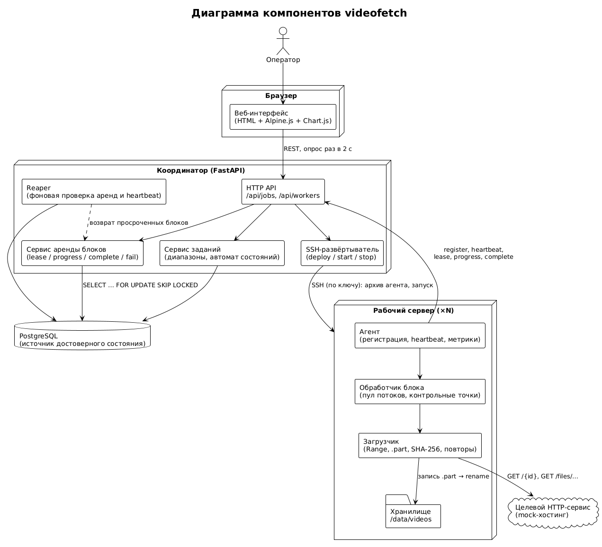
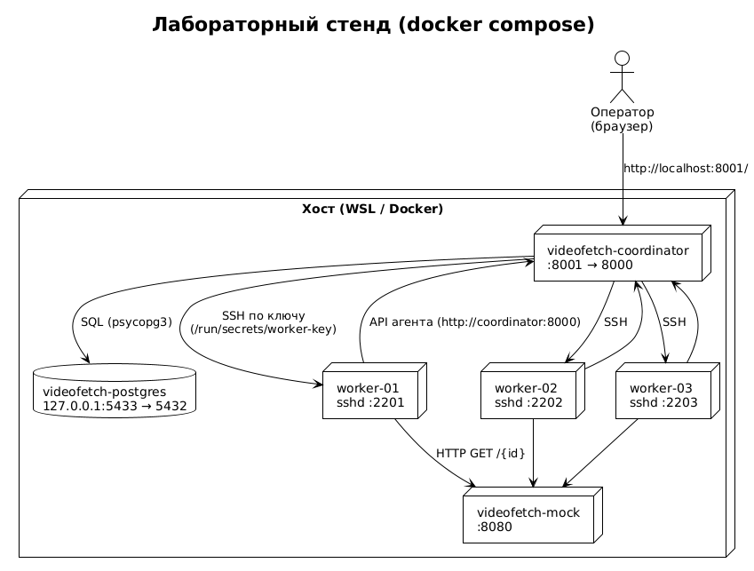
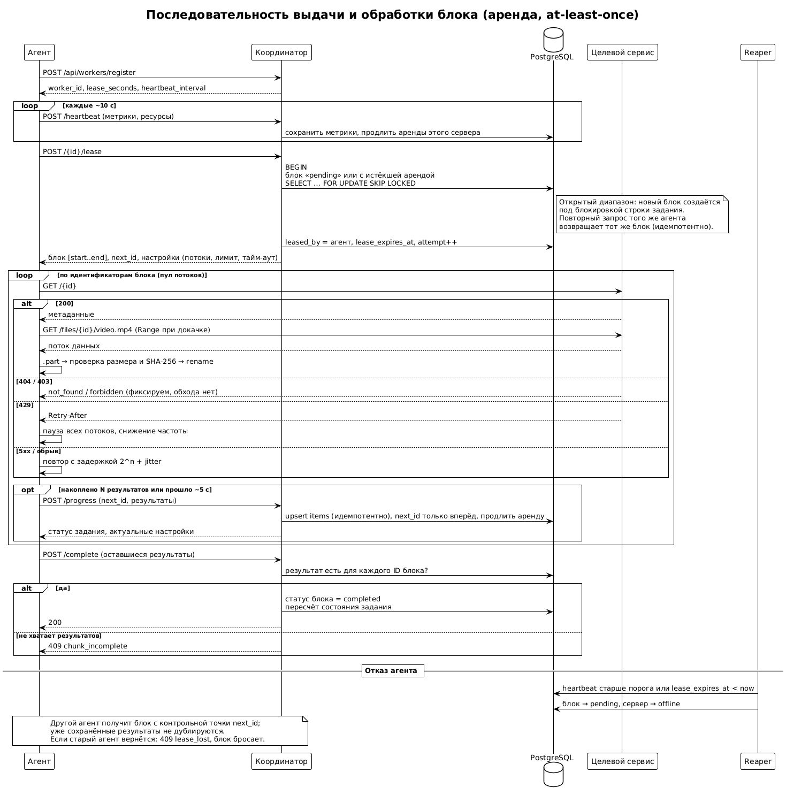
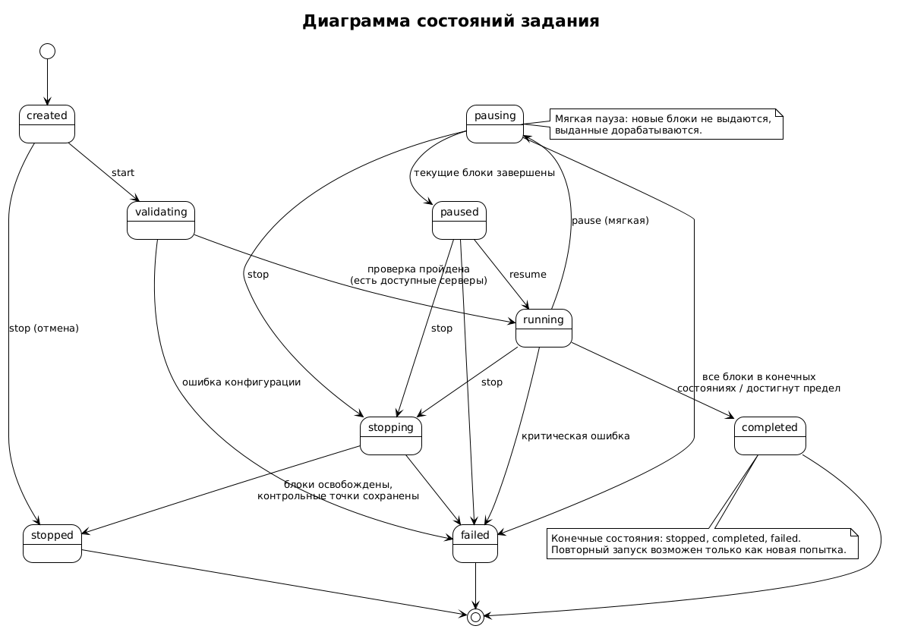
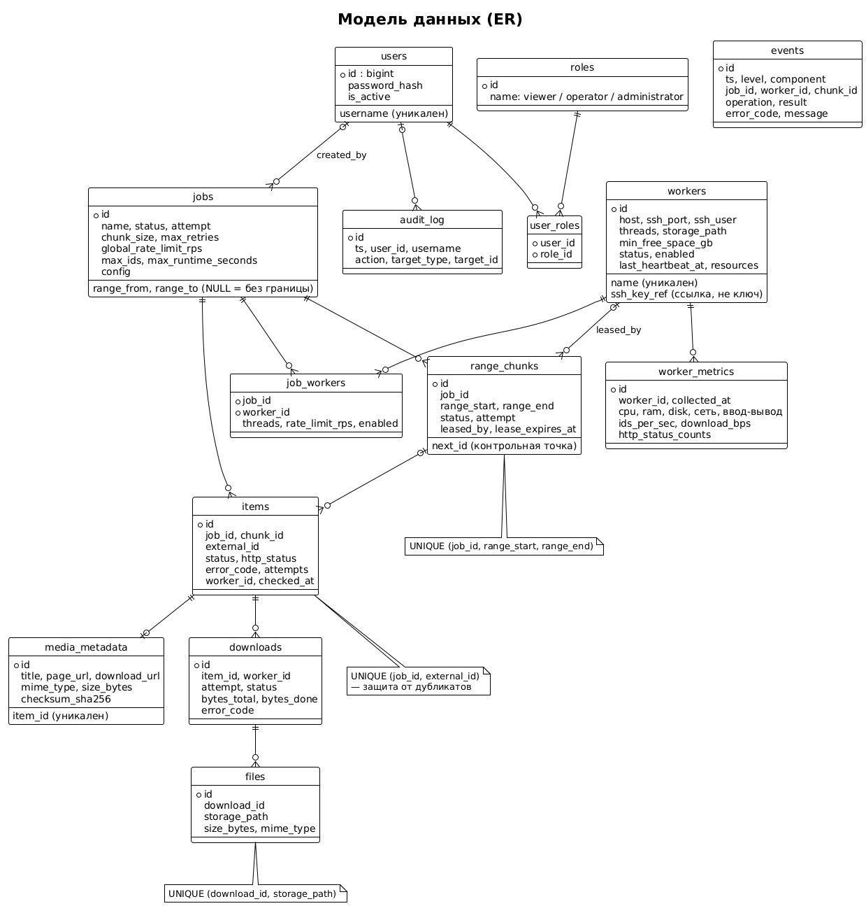

# Цель и постановка

Разработан программный комплекс из координатора, агентов рабочих серверов, веб-интерфейса и реляционного хранилища состояния. Система обходит диапазон числовых идентификаторов, проверяет наличие видеоматериала, получает метаданные, скачивает файлы и распределяет работу между серверами небольшими арендуемыми блоками. Главный принцип: **координатор управляет состоянием и раздаёт небольшие блоки с арендой, агенты самостоятельно выполняют ограниченную параллельную обработку и регулярно сообщают прогресс**.

Реализация на Python: FastAPI, SQLAlchemy 2.0, Alembic, PostgreSQL 16; веб-интерфейс — HTML, Alpine.js, Chart.js; стенд — docker compose (координатор, PostgreSQL, mock-сервис и три сервера с sshd).

## Целевой сервис и безопасность обхода

Работа выполняется **только с собственным управляемым mock-сервисом** (раздел 20 задания), а не с внешним сервисом. Шаблон адреса по умолчанию — `http://mock:8080/{id}`. Координатор принимает только адреса из белого списка хостов (`VF_ALLOWED_TARGET_HOSTS`), а агент дополнительно проверяет, что ссылка на файл ведёт на тот же хост, что и шаблон задания. Ответы 401/403 фиксируются как «недоступно» без попыток обхода.

Mock-сервис детерминированно генерирует результат для каждого идентификатора (200/404/403), умеет отдавать файлы разных размеров с поддержкой `Range` и контрольной суммой SHA-256, а через управляющее API включает задержки, ответы 429 с `Retry-After`, случайные 500 и обрывы соединения.

# Архитектура

{width=95%}

**Координатор** (FastAPI) хранит всё достоверное состояние в PostgreSQL и после перезапуска восстанавливает его из БД. Он включает HTTP API, сервис заданий (диапазоны и автомат состояний), сервис аренды блоков, фоновый Reaper и SSH-развёртыватель агентов.

**Агент** (только стандартная библиотека Python, `psutil` опционально) регистрируется, шлёт heartbeat с метриками, берёт блок, обрабатывает его пулом потоков, скачивает файлы и отчитывается контрольными точками. Агент никогда не получает весь диапазон целиком.

{width=80%}

## Динамические блоки и аренда

Диапазон делится на блоки настраиваемого размера (по умолчанию 1000 идентификаторов). Для открытого диапазона новые блоки создаются по мере выдачи, под блокировкой строки задания. Выдача блока атомарна: `SELECT … FOR UPDATE SKIP LOCKED` не позволяет выдать один блок двум агентам. Блок с истёкшей арендой выдаётся повторно другому серверу и продолжается с контрольной точки `next_id`.

Гарантия — **at least once**: повторная обработка возможна, поэтому сохранение результатов идемпотентно (`INSERT … ON CONFLICT DO UPDATE` по `(job_id, external_id)`, уже `completed` не затирается, `next_id` двигается только вперёд, повторное `lease` и `complete` безопасны).

{width=100%}

## Состояния задания

Переходы определены формально (`coordinator/app/statuses.py`); конечные состояния — `stopped`, `completed`, `failed`. Завершённое задание нельзя перевести в `running`. Мягкая пауза (`pausing → paused`) запрещает выдачу новых блоков и даёт доработать выданные; остановка освобождает аренды и сохраняет контрольные точки.

{width=75%}

# Модель данных

Создано 15 таблиц (включая справочник ролей), миграции Alembic проверены на PostgreSQL. Агент передаёт вместе с результатом метаданные материала и описание скачанного файла; координатор идемпотентно сохраняет их в `media_metadata`, `downloads` и `files` (повторная отправка не создаёт дублей, при ошибке загрузки метаданные сохраняются без записи о файле). Уникальные ограничения защищают от дубликатов: `items(job_id, external_id)`, `range_chunks(job_id, range_start, range_end)`, `files(download_id, storage_path)`.

{width=100%}

# Агент

**Проверка идентификатора.** 200 → найдено, метаданные из JSON; 404 → `not_found`; 401/403 → `forbidden`; 429 → пауза всех потоков на `Retry-After` (лимит ожиданий, затем `rate_limited`); 5xx и сетевые ошибки → повтор с задержкой `min(cap, base·2^n)` и полным джиттером, затем `failed`.

**Загрузка.** Файл пишется в `*.part`, при обрыве докачивается заголовком `Range` с того же места (если сервер игнорирует `Range` — начинается заново), затем проверяются размер и SHA-256 и выполняется атомарное переименование; рядом записывается `metadata.json`. Повреждённый файл удаляется. Уже скачанный и проверенный файл повторно не загружается. Перед загрузкой проверяется свободное место.

**Структура хранения и безопасность путей.** Файлы сохраняются как `{хранилище}/{префикс}/{id}/video.{расширение}` и `metadata.json` рядом (префикс — `id // 1 000 000`, например `200/200673499/`; расширение — по MIME-типу). Название материала в пути **не участвует** (хранится только в `metadata.json` и в БД), поэтому враждебные названия (`../../etc/passwd`, управляющие символы, зарезервированные имена) не могут повлиять на путь. Итоговый путь проверяется на нахождение внутри каталога хранения (включая символьные ссылки); `metadata.json` пишется атомарно. Координатор, в свою очередь, принимает от агента только относительный путь без `..`, абсолютных и пустых частей. Функции нормализации имён сохранены и покрыты тестами.

**Ограничение частоты.** Общий для потоков ограничитель запросов в секунду, настраиваемый на лету; пауза после 429 действует на все потоки. Контрольная точка блока — первый незавершённый идентификатор, поэтому при отказе повторная работа минимальна. Числа потоков и лимиты, изменённые в интерфейсе, агент подхватывает из ответа на `progress` без остановки задания.

**Устойчивость к сбоям координатора.** Ответы 5xx и недоступность координатора агент пережидает и повторяет, не считая это ошибкой блока; ошибки 4xx (нарушение протокола) не скрываются. Потеря аренды (`409 lease_lost`) приводит к тихому отказу от блока.

# Веб-интерфейс

Страница `/ui/` (опрос API раз в 2 секунды). Вкладка «Задания»: создание, список, прогресс-бар, счётчики результатов с фильтром, блоки, элементы с пагинацией, таблица скачанных файлов (название, размер, SHA-256, путь, сервер), события; запуск, пауза, продолжение, остановка; изменение числа потоков и лимита на лету, глобально и по каждому серверу; отключение сервера в задании. Вкладка «Серверы»: добавление, статус, версия агента, свободное место, время heartbeat; проверка SSH, развёртывание, запуск и остановка агента; графики метрик (ID/с, скорость загрузки, CPU, активные запросы).

# API

| Метод | Путь | Назначение |
|:--|:--------------|:----------------------------|
| POST/GET | `/api/jobs`, `/api/jobs/{id}` | создание, список, карточка со статистикой |
| PATCH | `/api/jobs/{id}` | изменение потоков и лимитов на лету |
| POST | `/api/jobs/{id}/start`, `pause`, `resume`, `stop` | управление заданием |
| PUT | `/api/jobs/{id}/workers/{wid}` | параметры сервера в задании |
| GET | `/api/jobs/{id}/items`, `files`, `chunks`, `events` | результаты, скачанные файлы, блоки, журнал |
| POST/GET/PATCH | `/api/workers`, `/api/workers/{id}` | серверы |
| POST | `/api/workers/register` | регистрация агента |
| POST | `/api/workers/{id}/heartbeat`, `lease`, `progress`, `complete`, `fail` | протокол агента |
| GET | `/api/workers/{id}/metrics` | метрики |
| POST/GET | `/api/workers/{id}/agent/check`, `deploy`, `start`, `stop`; `GET .../agent` | управление агентом по SSH |

Ошибки возвращаются как `{"error": "<код>", "message": "..."}` с HTTP-кодами 404/409/422/502. Полная интерактивная документация — `/docs`.

# Безопасность

Реализовано:

- Секреты вне кода и БД: для сервера хранится только ссылка `ssh_key_ref` на файл внутри каталога секретов (`/run/secrets`), в ответах API она не отображается; тест проверяет, что содержимое ключа не попадает в ответы, команды и события.
- Развёртывание только по SSH-ключам (`BatchMode=yes`), отпечаток хоста запоминается при первом подключении; все значения в команде проходят строгие шаблоны (защита от внедрения аргументов), ключ обязан лежать внутри каталога секретов, обход через символьные ссылки блокируется.
- Проверка входных параметров (Pydantic): диапазоны, пути хранилища (абсолютные, без `..`), имена; белый список целевых хостов.
- Агент работает без прав root; запись только внутри каталога хранения.
- Веб-интерфейс выводит данные через `x-text` (экранирование), собственных `innerHTML` нет.

Запланировано и **пока не реализовано**: аутентификация и роли viewer/operator/administrator, TLS, CSRF-защита, журнал аудита (таблицы `users`, `roles`, `audit_log` созданы миграциями), проверка идентичности и подпись сообщений агентов, SSH-терминал в браузере.

# Тестирование

## Модульные и интеграционные тесты

Автоматические тесты (pytest) покрывают: разбор и границы диапазона, разбиение на блоки, автомат состояний, нормализацию имён и проверку путей, расчёт задержек повторов и разбор `Retry-After`, ограничитель частоты; выдачу блоков без пересечений, продление аренды, возврат блока после истечения аренды и отказа, идемпотентность повторных сообщений, мягкую паузу и остановку, приоритет потоков (индивидуально над глобальным), деление глобального лимита между серверами, паузу выдачи при нехватке места; загрузку с докачкой по `Range`, обрыв, несовпадение контрольной суммы, враждебные названия; HTTP API сквозным сценарием; развёртывание по SSH (с подменой клиента); параллельную выдачу блоков восемью потоками на настоящем PostgreSQL (ни один блок не выдан дважды, пропусков нет).

## Сценарии отказов на живом стенде

Скрипт `loadtests/chaos.py` запускается на работающем стенде (3 агента, mock, PostgreSQL), вносит сбой во время выполнения задания, затем сверяет итог с «истиной» mock-сервиса: результат есть для каждого идентификатора, статусы совпадают, файлы скачаны и их SHA-256 верны, недокачанных файлов нет.

| Сценарий | Сбой | ID | Файлов | Время, с | Итог |
|:----------|:--------------------------|---:|---:|---:|:--|
| baseline | — | 200 | 42 | 6 | пройден |
| flaky_mock | 15 % ответов 500, 15 % обрывов загрузки, окно 429 на 8 с | 400 | 86 | 19 | пройден |
| kill_agent | `kill -9` агента во время блока | 600 | 116 | 47 | пройден |
| coordinator_restart | перезапуск координатора | 400 | 83 | 17 | пройден |
| postgres_restart | перезапуск PostgreSQL | 400 | 65 | 11 | пройден |
| stop_resume | пауза → проверка неподвижности прогресса → продолжение | 300 | 57 | 20 | пройден |

В сценарии `kill_agent` проверено, что сервер получил статус `offline` и что блок убитого агента был выдан повторно (`attempt > 1`). Дефект, найденный при подготовке сценариев: агент считал ответ 5xx координатора ошибкой блока; исправлено (теперь пережидает), добавлены тесты.

## Нагрузочное тестирование

Распределение подтверждено прогоном при замедленном mock: 12 блоков равномерно разошлись между тремя серверами. **Нагрузочные испытания целевого масштаба** (не менее 100 параллельных операций, десятки агентов, большие файлы) в этой версии не проводились и остаются в плане работ.

# Соответствие критериям приёмки

| Критерий | Статус |
|:----------------------------------------|:--------------|
| Все форматы диапазона | выполнено (тесты) |
| Не менее трёх серверов | выполнено |
| Динамическая выдача, нет простоя при наличии работы | выполнено |
| Потоки глобально и индивидуально | выполнено |
| Нет дублей записей и файлов | выполнено (ограничения БД, `chaos.py`) |
| Блок отключённого агента → другому серверу | выполнено (`kill_agent`) |
| Восстановление координатора | выполнено (`coordinator_restart`) |
| Продолжение частичной загрузки | выполнено (тесты, `flaky_mock`) |
| Нехватка места → нет новых заданий | выполнено на стороне координатора (`disk_low`), тест; стенд-демонстрация не проводилась |
| Интерфейс: прогресс, скорость, метрики | частично: есть прогресс, метрики и таблица скачанных файлов; нет списка активных загрузок с прогрессом каждого файла |
| Запуск, пауза, продолжение, остановка | выполнено |
| Классификация ошибок в журнале | частично |
| 429 → снижение частоты | выполнено (пауза по `Retry-After`); адаптивное снижение при росте 429/5xx не реализовано |
| SSH под ролевой моделью и аудитом | **не выполнено** (SSH только по ключам, без ролей) |
| Секреты не в коде, API и журналах | выполнено |
| Нет обхода ограничений | выполнено |
| Тесты проходят | выполнено |

# Ограничения и известные проблемы

- Нет аутентификации, ролей, TLS и аудита; API открыт в пределах лабораторной сети.
- Нет предупреждений (алертов) и адаптивного ограничения нагрузки; не реализовано условие остановки по числу подряд отсутствующих идентификаторов.
- Веб-интерфейс подключает Alpine.js и Chart.js с CDN; для стенда без доступа в интернет библиотеки нужно разместить локально.
- Отпечаток SSH-хоста запоминается в файле внутри контейнера и теряется при его пересоздании.
- Нагрузочные испытания целевого масштаба не проводились; метрики хранятся без ограничения срока.

# Установка и запуск

Требования: Docker с compose, Python 3.12+ (для тестов), WSL или Linux.

```bash
cd deploy
./gen-keys.sh                    # ключ для SSH-доступа к рабочим серверам
docker compose up -d --build     # PostgreSQL, mock, координатор, 3 сервера
until curl -fsS http://localhost:8001/healthz; do sleep 2; done
./smoke.sh                       # серверы, агенты, задание на [0,299]
```

Веб-интерфейс: `http://localhost:8001/`, документация API: `/docs`. Миграции применяются автоматически при старте координатора. Тесты: `pytest -q`; тест на PostgreSQL — переменная `VF_TEST_DATABASE_URL`; сценарии отказов — `python3 ../loadtests/chaos.py`.

Обновление агентов: пересобрать координатор (он раздаёт код агента) и выполнить «Остановить → Развернуть → Запустить» в интерфейсе либо через `/api/workers/{id}/agent/...`.

# Руководство оператора

1. **Серверы.** Вкладка «Серверы» → добавить (имя, хост, SSH-порт, пользователь, путь ключа на координаторе, каталог хранилища, потоки) → «Проверить SSH» → «Развернуть» → «Запустить». Статус станет «онлайн» после первого heartbeat.
2. **Задание.** Вкладка «Задания» → форма: диапазон (`[A,B]`, `A`, `[A,]` или пусто), размер блока, потоки, лимит запросов в секунду, серверы → «Создать» → «Запустить».
3. **Управление.** «Пауза» — мягкая (выданные блоки дорабатываются); «Продолжить»; «Остановить» — необратимо, аренды освобождаются. Потоки и лимит меняются без остановки.
4. **Мониторинг.** Прогресс и счётчики на карточке задания, события внизу; графики по серверу — клик по имени на вкладке «Серверы».
5. **Сбой сервера.** Через интервал heartbeat сервер получает статус «офлайн», его блок вернётся в очередь и достанется другому; после восстановления — «Запустить» агента.

# Демонстрационный сценарий отказа сервера

```bash
curl -s -X POST localhost:8080/_control/config -H 'Content-Type: application/json' \
     -d '{"delay_ms":30,"chunk_delay_ms":100}'                  # замедлить mock
# в интерфейсе: создать задание [0,599], размер блока 50, три сервера, запустить
docker compose exec worker-02 pkill -9 -f videofetch_agent      # убить агента
# через ~30 с worker-02 → «офлайн», его блок выдан повторно (attempt 2) другому серверу
# задание доходит до «завершено»; «Запустить» агента на worker-02 возвращает его в работу
curl -s -X POST localhost:8080/_control/reset
python3 ../loadtests/chaos.py kill_agent                         # то же с автоматической проверкой
```
